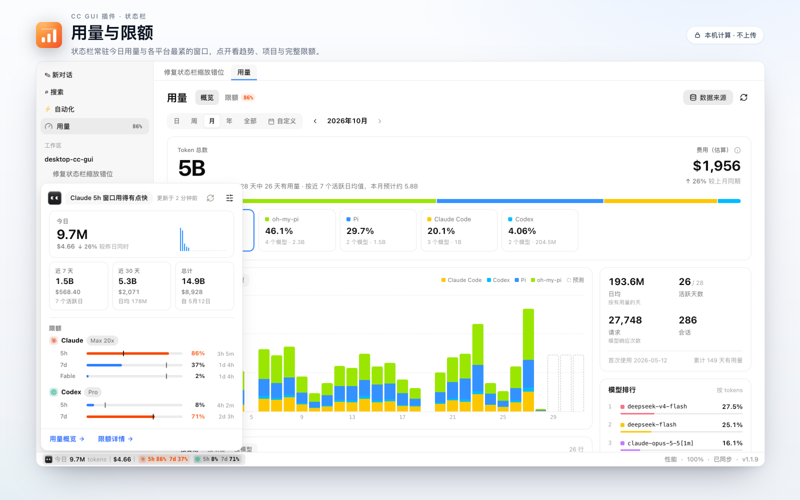
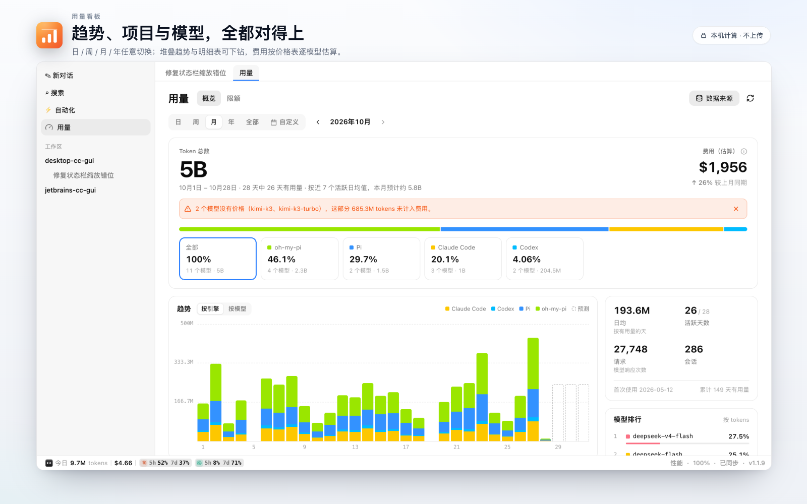
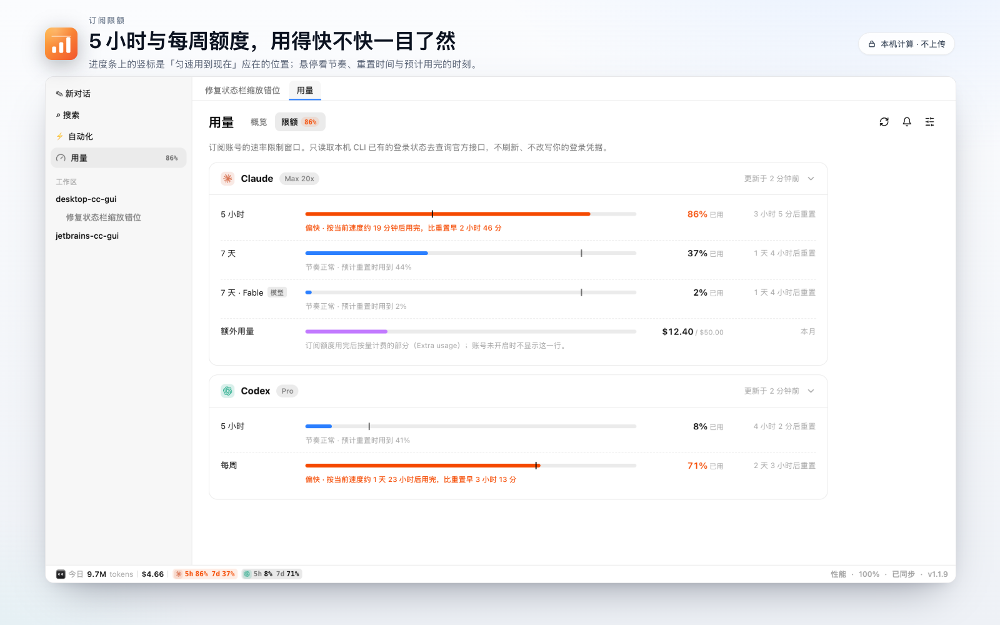
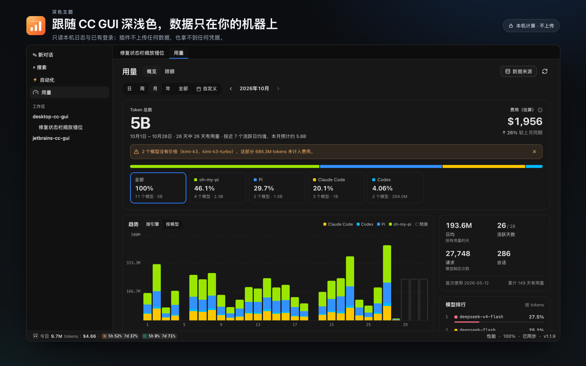

# 用量与限额 · CC GUI 插件

<p align="center"></p>

<p align="center"><b>在状态栏看今天用了多少 token、估算花了多少钱；点开看趋势、项目与模型明细；<br/>顺手盯住 Claude / Codex 订阅的 5 小时与每周限额。</b></p>

<p align="center">
  <a href="https://github.com/zhukunpenglinyutong/ccgui-plugin-usage-limits/releases"></a>
  
  
  
</p>

> **上架状态**：索引 PR 已提交，等 CC GUI **1.1.9**（插件 SDK 0.3.23）发版后上架。
> 在那之前可以从**本地目录**或 **Release 三件套**安装。



| 用量看板 | 订阅限额 |
|---|---|
|  |  |



## 它能做什么

- **状态栏芯片**：默认「今日 12.3M tokens 丨 $4.56」，后面常驻每个平台的 5 小时与每周窗口
  （带平台图标，如「✳ 5h 86% 7d 37%」「◍ 5h 8% 7d 71%」）。不用等快用完才出现；
  达到提醒阈值（默认 80% / 95%）才转成告警色。启动时先显示上次缓存的数字。
- **弹出面板**：今日（含与「昨日同一时刻为止」的对比、24 小时分布）、近 7 / 30 天与总计；
  点今日或下方卡片在原位展开 token 明细（输入 / 输出 / 缓存读 / 缓存写 / 缓存命中），不跳转；
  点气泡切换「较昨日同时 / 今日 tokens / 今日账单」三种说法，5 秒自动轮换。
- **用量页签**（侧栏「用量」或 ⌘K「打开用量」）：
  - 概览：日 / 周 / 月 / 年 / 全部 / 自定义区间（最长 366 天）、同期对比、未知价格提示、
    引擎筛选、堆叠趋势（含预测、键盘可操作、点击下钻）、按时间 / 项目 / 模型的可排序明细、
    项目抽屉、统计卡、模型排行（每个模型一个稳定配色）、近 26 周热力图、数据来源与重新扫描。
  - 限额：每个平台一张可折叠卡片，竖标是「匀速用到现在」应在的位置；悬停任一行看节奏、
    重置时间与预计用完的时刻；额外用量、Codex 免费档每周窗口、限流 / 网络失败的旧数据与重试。
- **设置**（设置 › 插件 › 用量与限额）：状态栏显示内容与顺序、限额刷新间隔、数据来源、
  价格表自动更新、隐私与来源。

## 安装

| 方式 | 步骤 |
|---|---|
| 市场（待上架） | CC GUI → 插件 → 市场 → 搜索「用量与限额」（需 CC GUI ≥ 1.1.9） |
| 从本地目录 | CC GUI → 插件 → **从本地目录安装** → 选择本仓库根目录（`manifest.json` / `main.js` / `styles.css` 同级） |
| 从 Release | 下载最新 Release 的 `main.js` / `manifest.json` / `styles.css`，放进一个目录后按上一条安装 |

`dist/` 里是构建产物三件套，和根目录的同名文件一致。

## 数据从哪来、去哪

| 数据 | 来源 | 插件能看到什么 |
|---|---|---|
| Token 用量与估算费用 | **CC GUI 宿主**在本机扫描各 CLI 的会话日志（Claude Code、Codex、Pi、oh-my-pi），按天 / 小时 × 引擎 × 模型 × 项目建索引，并按价格表估算费用 | 只读聚合行（`ctx.usage.query`），不含对话内容 |
| 订阅限额 | **宿主**用本机 CLI 已有的登录（Claude Code：macOS 钥匙串 / `~/.claude/.credentials.json`；Codex：`~/.codex/auth.json`）**只读**查询官方接口 | 百分比、窗口时长、重置时间、套餐名；**凭据只在宿主 Rust 进程里，插件拿不到** |
| 价格表 | 宿主内置快照；开启「自动更新」后每 24 小时下载一次 LiteLLM 的公开价格表 | 快照日期与模型数 |
| 工作区名称 | `ctx.workspaces.list()` | 用来把会话 cwd 归到侧栏工作区（最长前缀匹配，含 worktree），其余计入「其他目录」 |

- **不上传任何数据**。插件没有 `network:` / `exec:` 授权；价格表下载由宿主执行，只下载公开文件。
- 插件不刷新、不改写任何登录凭据；未登录 / 登录过期时只给出终端命令（`claude` / `codex login`）和复制按钮。
- 偏好设置存在插件自己的 KV（`ctx.storage`）。

## 权限

| 权限 | 用途 |
|---|---|
| `usage.read` | 读取宿主计算好的用量聚合、数据来源、价格表信息；触发增量刷新 / 重新扫描 / 价格表更新 |
| `limits.read` | 读取 Claude / Codex 限额（百分比与重置时间） |
| `ui:status-bar` / `ui:sidebar-entry` / `ui:center-tab` / `ui:settings-section` / `ui:command` | 状态栏芯片、侧栏入口（带徽标）、用量页签、设置页、⌘K 命令 |
| `events` | 订阅 `usage://done`（一轮对话结束后 2 秒内增量刷新）与 `usage://updated`（「运行中」状态） |
| `host:workspace` | 读取侧栏工作区列表，把项目路径映射成工作区名 |
| `storage` | 保存偏好、上次状态栏数字、价格表自动更新时间 |

需要宿主 **SDK ≥ 0.3.23**（`usage.read` / `limits.read`）与 **CC GUI ≥ 1.1.9**。

## 开发

要求 **Node ≥ 22.18**（单测直接跑 `.ts`，依赖 Node 的类型剥离），以及本机安装 Chrome
（预览 / 截图脚本用系统 Chrome，可用 `CHROME=/path/to/chrome` 覆盖）。

```bash
npm install          # 含 vendor/plugin-ui（file: 依赖，见下）与 playwright-core
npm run typecheck    # tsc --noEmit
npm test             # node --test：领域层 / 数据层 / React shim
npm run coverage     # 同上 + 覆盖率（src/domain、src/data、src/shim）
npm run build        # esbuild → 根目录 main.js + styles.css，并复制到 dist/
npm run preview      # 构建后在无头 Chrome 里跑 mock 宿主：截图 + 交互断言（见 preview/）
npm run assets       # 重新生成 docs/icon.png 与 docs/screenshot-1…4.png（市场展示素材）
```

`npm run preview` 会把每个界面按浅色 / 深色各截一张到 `preview/shots/`（已 gitignore），
并跑 40+ 条交互断言（弹出面板、周期切换、下钻、限额状态、设置、减少动态效果等）。

### `@ccgui/plugin-ui` 是 vendored 的

`@ccgui/plugin-ui` 目前还没发布到 npm，所以 `vendor/plugin-ui/` 放了一份从 CC GUI 仓库
（`desktop-cc-gui/packages/plugin-ui`，MIT）复制过来的源码，`package.json` 用
`file:vendor/plugin-ui` 引用它。构建时它被 bundle 进 `main.js` / `styles.css`，运行时
不从网络加载任何东西。上游更新时同步 `src/`、`styles.css` 与包字段再重新构建即可
（详见 [`vendor/plugin-ui/VENDORED.md`](./vendor/plugin-ui/VENDORED.md)）。

### React 怎么来的

Tier-1 插件不能自带 React，宿主按 URL `import()` 加载 `main.js`，裸 `import "react"` 运行时无法解析。
构建时把 `react` / `react/jsx-runtime` 指到 `src/shim/`：`activate` 第一行 `bindReact(ctx.react)`，
之后所有 hooks / `createElement` 在**调用时**转发给宿主的 React；`forwardRef` / `memo`（plugin-ui 在模块
求值时就会调用）直接返回 React 标准的元素类型对象，不需要 React 实例。`jsxs`（静态子节点）以可变参数
传 children，与 React 自己的 jsxs 一样不会误报 key 警告。

### 代码结构

| 目录 | 职责 |
|---|---|
| `src/domain/` | 纯函数：日期与周期（周一开始）、同期对比、预测、趋势分桶、热力图分位、限额节奏与告急阈值、缓存命中率、格式化、cwd → 工作区映射、排序、偏好校验 |
| `src/data/` | 外部 store 与服务：用量查询 / 缓存 / 增量刷新、限额轮询（只在可见时）、偏好持久化 |
| `src/ui/` | 组件：状态栏芯片与面板、用量页（概览 / 限额）、设置、CC GUI 标志与平台图标 |
| `src/i18n/` | 简体中文与英文（`ctx.host.locale` 以 zh 开头用中文，其余用英文） |
| `src/styles/` | 只用宿主语义 token（带浅色 fallback），深色随宿主 token 翻转 |
| `preview/` | 仅开发用：假 ctx + 假数据 + mock 宿主框架 + Playwright 截图与交互脚本，不进产物 |
| `docs/` | 市场展示素材：`icon.svg` / `icon.png` / `screenshot-1…4.png`，由 `npm run assets` 生成 |
| `vendor/plugin-ui/` | 未发布到 npm 的 `@ccgui/plugin-ui` 源码副本（MIT） |

## 已知限制

- 项目抽屉的「在侧栏定位工作区」没有做：SDK 没有让插件定位 / 高亮侧栏工作区行的接口，
  不放做不到的按钮。
- 插件无法打开外部链接（没有 opener 能力），设置页里的 TokenTracker 与第三方声明以链接文本 + 「复制链接」呈现。
- 「数据来源」里关掉某个 CLI 只是在本插件的统计里隐藏它，宿主仍会读取该目录。
- 系统通知、韩语界面暂未提供。
- 告急提醒目前表现为状态栏限额标签变色 + 侧栏百分比徽标；系统通知需要宿主为插件开放能力后再补。

## 来源与许可

本插件的**交互与信息架构**参考了 **[TokenTracker](https://github.com/xiufengsun/tokentracker)（MIT）**，
不是 TokenTracker 官方出品，也与 TokenTracker 作者无隶属关系。

- 参考的是 TokenTracker **1.4.15**（commit `4cf3e212`）的：菜单栏摘要与弹出面板的信息结构、
  限额页（每个窗口一条进度条 + 「时间进度」节奏刻度 + 重置倒计时 + 未登录 / 过期 / 限流状态）、
  概览页（日 / 周 / 月 / 年 / 全部 / 自定义周期、引擎占比卡片、热力图、堆叠趋势、按日明细表）。
- **只参考思路，不复用任何代码或素材**：视觉全部走 CC GUI 自己的设计 token 与 `@ccgui/plugin-ui`
  组件；状态栏标记使用 CC GUI 应用图标，其余文案与实现均为原创。
- **刻意没有使用**：TokenTracker 的 **Clawd** 吉祥物及全部吉祥物 / 桌宠素材、3D 热力图、
  React Bits `ElectricLogo`（Commons Clause）、任何遥测 / 统计上报。
- **平台标识**：限额列表与状态栏用 Claude（Anthropic）与 OpenAI（Codex）的图形标识来标注是哪个 CLI，
  几何来自 [LobeHub 图标集](https://github.com/lobehub/lobe-icons)（MIT）。商标归各自公司，仅用于识别，
  不代表隶属关系；声明见 [`THIRD_PARTY_NOTICES.md`](./THIRD_PARTY_NOTICES.md)。
- 上游采用 **MIT 许可证**（Copyright © 2026 xiufengsun）。按 MIT 要求，上游版权声明与许可证全文
  收录在 [`THIRD_PARTY_NOTICES.md`](./THIRD_PARTY_NOTICES.md)，并逐条列出参考了什么、没用什么；
  图标几何来自 Lucide（ISC），声明同在该文件。
- 本插件自身许可同样是 MIT（Copyright © 2026 zhukunpenglinyutong），见 [`LICENSE`](./LICENSE)。
- 商标归属：Claude / Claude Code 属于 Anthropic PBC，Codex / ChatGPT 属于 OpenAI，此处仅用于标识
  CC GUI 读取的是哪个 CLI 的本机数据。

如果你（或 TokenTracker 作者）对参考方式有异议，欢迎开 issue，我们会调整或下架。

---

## English summary

A CC GUI Tier-1 plugin that shows today's tokens and estimated cost in the
status bar, plus an always-on tag per provider with its 5-hour and weekly
Claude / Codex windows (each tagged with the provider's logo). It also brings
a popover with today / 7-day / 30-day / all-time totals, a cache-hit figure
and subscription limit bars, a usage tab (overview dashboard with period
navigation, trend, heatmap, project / model breakdowns, plus a limits page
with pace projections) and a settings section.

All numbers are **computed locally by the CC GUI host** from the CLIs' own
session logs (SDK `usage.read`); limits are read-only queries the host makes
with the CLIs' existing logins (`limits.read`) — credentials never reach the
plugin, and the plugin uploads nothing (no `network:` / `exec:` grants).

The interaction design references **TokenTracker (MIT, © 2026 xiufengsun)**,
v1.4.15 (`4cf3e212`). No TokenTracker code or assets are used — not the Clawd
mascot or any pet sprite, not the 3D heatmap, not React Bits ElectricLogo
(Commons Clause), not telemetry. The status mark is the CC GUI app icon, this
project's own artwork; the provider marks are Claude / OpenAI logos from the
MIT LobeHub icon set, used only to label which CLI's quota a row shows. See
[`THIRD_PARTY_NOTICES.md`](./THIRD_PARTY_NOTICES.md).

Install: CC GUI → Plugins → *Install from local folder* → this directory, or
drop the three release files into a folder. Build: `npm install && npm run
build`. Requires CC GUI ≥ 1.1.9 (plugin SDK ≥ 0.3.23).
